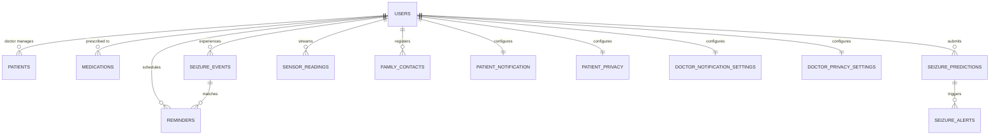

# NeuroGuard AI — Database Architecture & Firebase Migration Audit

**Audit Date:** September 3, 2026  
**Scope:** MySQL / XAMPP Database, SQLite Fallback (`neuroguard_ai_fallback.db`), DDL Schemas, PHI Data Ownership, and Firebase Migration Planning  
**Mission Type:** Forensic Read-Only Audit (No Data Migration / No Schema Deletions)

---

## 1. CURRENT DATABASE ARCHITECTURE

### A. Dual-Mode Persistence Architecture
The backend uses a dual-mode persistence architecture implemented in [`lib/screens/auth/db_fallback.py`](file:///c:/Users/DELL/Downloads/NeuroGuard%20AI/lib/screens/auth/db_fallback.py):
1. **Primary Database Engine:** MySQL running on localhost (`127.0.0.1:3306`), database name `neuroguard_ai`, default user `root` (XAMPP standard).
2. **Graceful Local Fallback Engine:** SQLite database [`neuroguard_ai_fallback.db`](file:///c:/Users/DELL/Downloads/NeuroGuard%20AI/neuroguard_ai_fallback.db) located in the repository root. When MySQL is unreachable or offline, the server automatically routes all SQL queries to SQLite without application downtime.
3. **Framework Clarification:** The backend is built on **Python Flask** (not Django). There are no Django ORM models, serializers, or Django migrations. Database DDL is executed on server startup via raw SQL statements inside `init_db()` in [`app.py`](file:///c:/Users/DELL/Downloads/NeuroGuard%20AI/lib/screens/auth/app.py) and `create_seizure_predictions_table()` in [`seizure_prediction_api.py`](file:///c:/Users/DELL/Downloads/NeuroGuard%20AI/lib/screens/auth/seizure_prediction_api.py).

---

## 2. COMPLETE DATABASE TABLE INVENTORY (17 TABLES)

| # | Table Name | Engine | Active Records | Primary Key | Key Columns & Types | Description & Purpose |
| :- | :--- | :--- | :- | :--- | :--- | :--- |
| **1** | `users` | Dual (MySQL/SQLite) | 6 | `id` (INT/INTEGER) | `name`, `email` (UNIQUE), `phone`, `password` (bcrypt hash), `role` (`patient`/`doctor`), `age`, `gender`, `created_at` | Core user identity, credentials, and role assignments |
| **2** | `patients` | Dual (MySQL/SQLite) | 1 | `id` (INT/INTEGER) | `patient_id` (VARCHAR), `doctor_id` (INT), `name`, `age`, `gender`, `medical_condition`, `email`, `phone`, `created_at` | Clinical patient profiles assigned to specific doctors |
| **3** | `medications` | Dual (MySQL/SQLite) | 5 | `id` (INT/INTEGER) | `user_id` (INT), `medicine_name`, `dose`, `frequency`, `timing`, `start_date`, `end_date`, `notes` | Patient active and past prescription records |
| **4** | `reminders` | Dual (MySQL/SQLite) | 3 | `id` (INT/INTEGER) | `user_id` (INT), `title`, `reminder_type` (`Medication`/`Appointment`), `reminder_date`, `reminder_time`, `is_completed` | Scheduled clinical alarms and medication timers |
| **5** | `seizure_events` | Dual (MySQL/SQLite) | 0 | `id` (INT/INTEGER) | `user_id`, `patient_id`, `seizure_type`, `event_date`, `event_time`, `severity`, `description`, `doctor_notes`, `is_acknowledged` | Patient/doctor confirmed seizure occurrences |
| **6** | `seizure_predictions`| Dual (MySQL/SQLite)| 0 | `id` (INT/INTEGER) | `user_id`, `patient_id`, `prediction_type`, `predicted_seizure_type`, `confidence_score`, `risk_level`, `eeg_file_name`, `eeg_file_data` (BLOB) | Historical AI ML inference outputs and raw EEG payloads |
| **7** | `seizure_alerts` | Dual (MySQL/SQLite) | 0 | `id` (INT/INTEGER) | `user_id`, `patient_id`, `prediction_id`, `alert_type`, `severity`, `alert_message`, `is_acknowledged`, `action_taken` | Triggered high-priority seizure alarms |
| **8** | `sensor_readings`| Dual (MySQL/SQLite) | 0 | `id` (INT/INTEGER) | `user_id`, `patient_id`, `heart_rate`, `body_temperature`, `accelerometer_x/y/z`, `gyroscope_x/y/z`, `fall_detected` | Raw physiological timeseries telemetry |
| **9** | `family_contacts`| Dual (MySQL/SQLite) | 0 | `id` (INT/INTEGER) | `user_id`, `name`, `phone_number`, `relationship`, `created_at` | Emergency SOS family contacts |
| **10**| `patient_notification` / `notification_settings` | Dual | 4 | `user_id` (INT) | `all_notifications`, `emergency_alerts`, `medication_reminders`, `appointment_reminders`, `device_status` | Patient push and in-app notification toggles |
| **11**| `patient_privacy` / `privacy_settings` | Dual | 2 | `user_id` (INT) | `share_data`, `share_research`, `public_profile`, `allow_data_collection` | Patient data privacy and research consent flags |
| **12**| `doctor_notification_settings` | Dual | 0 | `user_id` (INT) | `push_notifications`, `email_notifications`, `appointment_notifications`, `reminder_notifications` | Doctor clinical alert preferences |
| **13**| `doctor_privacy_settings` | Dual | 0 | `user_id` (INT) | `profile_visibility`, `share_activity`, `allow_messages` | Doctor clinical profile visibility toggles |
| **14**| `chats` / `chat_messages` | Dual | 0 | `id` (INT/INTEGER) | `user_id`, `text`, `is_user`, `timestamp`, `created_at` | Historical patient support chat messages |
| **15**| `connection_logs` / `wearable_connections` | Dual | 0 | `id` (INT/INTEGER) | `user_id`, `device_name`, `device_id`, `connection_status`, `signal_strength`, `timestamp` | Wearable hardware connectivity logs |
| **16**| `predictions` (Legacy) | Dual | 0 | `id` (INT/INTEGER) | `user_id`, `patient_id`, `prediction_type`, `predicted_value`, `confidence`, `created_at` | Simple legacy prediction cache |
| **17**| `patient_additions` (Legacy) | Dual | 0 | `id` (INT/INTEGER) | `patient_id`, `doctor_id`, `name`, `condition`, `created_at` | Legacy audit log table |

---

## 3. RELATIONSHIP MAP & FOREIGN KEY CONSTRAINTS



### Relational Vulnerabilities
- **No Explicit Foreign Key Enforcement:** Table DDL statements omit `FOREIGN KEY (...) REFERENCES users(id) ON DELETE CASCADE`.
- **Soft Deletion Absent:** Deleting a user does not clean up associated medications, reminders, or predictions, creating orphaned database records.

---

## 4. SENSITIVE DATA INVENTORY (PROTECTED HEALTH INFORMATION)

| Data Category | Tables / Files | Classification | Required Regulatory Controls |
| :--- | :--- | :--- | :--- |
| **Patient Demographics** | `users`, `patients` | Sensitive PHI | Encryption at rest, TLS 1.3 in transit, strict RBAC |
| **Clinical Diagnoses & History** | `patients` (`medical_condition`), `seizure_events` | Critical PHI | Doctor-patient privilege, audit logging |
| **Prescriptions & Doses** | `medications` | Critical PHI | Modification restricted strictly to licensed doctors |
| **Raw EEG Files & Waveforms** | `seizure_predictions` (`eeg_file_data`), temp files | Biometric PHI | Bucket ACLs, short-lived signed URLs (15m expiry) |
| **Emergency Contacts** | `family_contacts` | PII | Read restricted to patient and assigned emergency dispatch |
| **Physiological Telemetry** | `sensor_readings` | Continuous PHI | User-scoped read/write, automated retention pruning |
| **AI Seizure Predictions** | `seizure_predictions`, `seizure_alerts` | Clinical Diagnostic | Disclaimers, doctor verification required before treatment |

---

## 5. DATA OWNERSHIP & ACCESS CONTROL MATRIX

| Data Category | Data Owner | Who Can Read | Who Can Write | Who Can Delete | Retention & Recovery Concerns |
| :--- | :--- | :--- | :--- | :--- | :--- |
| **Auth Credentials** | User / System | System Only | User (via Auth API) | User (Account deletion) | Immediate credential revocation on password change |
| **Patient Profile** | Patient | Patient, Assigned Doctor | Patient, Assigned Doctor | Patient (Account deletion) | 7-year medical record retention compliance |
| **Medication Schedule**| Doctor / Patient | Patient, Assigned Doctor | Doctor Only | Doctor Only | Prescription history must remain immutable for audits |
| **Seizure Events** | Patient | Patient, Assigned Doctor | Patient, Assigned Doctor | Doctor / Patient | Critical clinical tracking; permanent retention |
| **Raw EEG Uploads** | Patient | Patient, Assigned Doctor | Patient | Patient | Large file size; archive to cold storage after 90 days |
| **Sensor Telemetry** | Patient | Patient, Assigned Doctor | Device / Ingestion API | System Lifecycle | High data volume; aggregate hourly after 30 days |
| **Emergency Contacts** | Patient | Patient, Emergency System | Patient | Patient | Immediate availability during SOS trigger |
| **Doctor Settings** | Doctor | Doctor Only | Doctor Only | Doctor Only | User-scoped preferences |

---

## 6. FIREBASE MIGRATION CANDIDATES & TARGET ARCHITECTURE

```mermaid
flowchart TD
    subgraph Client Application [Flutter Frontend]
        App[NeuroGuard AI App]
    end

    subgraph Firebase Cloud Platform
        Auth[Firebase Authentication\n- Email/Password\n- Custom Role Claims]
        Firestore[Cloud Firestore\n- users\n- patients\n- medications\n- reminders\n- seizure_events\n- family_contacts]
        Storage[Firebase Storage\n- /eeg_raw/{userId}/\n- /reports/{userId}/\n- /waveforms/{userId}/]
        FCM[Firebase Cloud Messaging\n- Emergency SOS Push\n- Medication Alarms]
    end

    subgraph Python Backend Engine [Compute Service]
        FlaskAPI[Python Backend Service\n- EEG Signal Preprocessing\n- Model Inference Pipeline\n- ReportLab PDF Compiler]
    end

    App -->|Authenticate| Auth
    App -->|Read/Write Clinical Data| Firestore
    App -->|Upload Large EEG Files| Storage
    App -->|Trigger Inference API| FlaskAPI
    FlaskAPI -->|Stream EEG File| Storage
    FlaskAPI -->|Send Background Alert| FCM
```

### A. Firebase Authentication Candidates
- **Target:** `users` table credentials.
- **Implementation:** Firebase Auth with Custom Claims (`role: 'patient'` or `role: 'doctor'`). Passwords re-hashed through standard Firebase Auth SDK.

### B. Cloud Firestore Candidates (Structured Document DB)
- **Target Collections:**
  - `users/{userId}`: Demographics, profile settings, notification/privacy preferences.
  - `patients/{patientId}`: Assigned doctor ID, clinical conditions, care notes.
  - `medications/{medicationId}`: Prescriptions, dosages, schedules.
  - `reminders/{reminderId}`: Medication and appointment alarm timestamps.
  - `seizure_events/{eventId}`: Confirmed seizure logs with doctor notes and timestamps.
  - `seizure_alerts/{alertId}`: High-priority alarms with acknowledgment states.
  - `family_contacts/{contactId}`: Emergency SOS contact records.

### C. Firebase Storage Candidates (Object Store)
- **Target Files:**
  - Raw EEG files (`.edf`, `.csv`, `.dat`) stored under path `/eeg_uploads/{userId}/{fileId}.edf`.
  - Generated clinical PDF reports stored under `/reports/{userId}/{reportId}.pdf`.
  - EEG waveform PNG renderings stored under `/waveforms/{userId}/{graphId}.png`.
- **Architectural Rule:** **NEVER store raw EEG binary BLOBs inside Firestore documents.** Firestore has a 1MB per-document limit and charges per read/write.

### D. Data That Must Remain Under Backend Control
- **EEG Digital Signal Processing:** Butterworth filters, Welch PSD calculations, and Hjorth parameters require Scipy/MNE in Python.
- **ML Model Inference & Training:** Scikit-learn, PyTorch, and patient-independent cross-validation engines must run on the server.
- **ReportLab PDF Compilation:** Complex multi-page clinical reports with embedded vector graphs.

---

## 7. CRITICAL MIGRATION RISKS & MITIGATION STRATEGIES

1. **Integer Auto-Increment IDs vs. Firebase String UIDs:**
   - *Risk:* Relational queries rely on integer `user_id = 1`. Firebase Auth generates alphanumeric strings (e.g. `d9Jk2L...`).
   - *Mitigation:* Create a migration ID translation lookup mapping `legacy_user_id (INT)` $\leftrightarrow$ `firebase_uid (STRING)` during the transition phase.
2. **Loss of Relational JOIN Capabilities:**
   - *Risk:* SQL queries like `LEFT JOIN reminders ON se.user_id = r.user_id` cannot be executed natively in Firestore.
   - *Mitigation:* Denormalize frequently co-queried fields into Firestore subcollections (e.g., `users/{userId}/reminders/{reminderId}`).
3. **Storage Quota & Cost Explosions:**
   - *Risk:* Uploading high-density 24-hour continuous EEG recordings (>50MB each) directly to Firestore will fail document size limits or inflate storage costs.
   - *Mitigation:* Route all file payloads directly to Firebase Storage buckets using secure signed upload URLs.
4. **Data Leakage During Dual-Write Phase:**
   - *Risk:* Inconsistencies between MySQL and Firestore during transitional dual-write operations.
   - *Mitigation:* Feature-flagged migration phases with cryptographic hash validation on migrated records.

---

## 8. BACKUP, VALIDATION, AND ROLLBACK PROTOCOL

### A. Pre-Migration Backup Requirements
1. **MySQL Snapshot:** Execute `mysqldump -u root neuroguard_ai > pre_migration_backup.sql`.
2. **SQLite Binary Copy:** Create SHA-256 verified snapshot copy `neuroguard_ai_fallback.db.bak`.
3. **ML Model Checkpoint:** Confirm artifacts in `ml_models/` remain unmodified.

### B. Parity Validation Requirements
- Execute automated cross-verification script comparing record counts and column checksums between SQL tables and Firestore collections before cutting over read traffic.

### C. Instant Rollback Requirement
- Maintain MySQL/SQLite database connection shims active via environment flag `USE_FIREBASE_DATASTORE=false` to enable instantaneous zero-downtime rollback if Firestore latency or auth errors occur.
