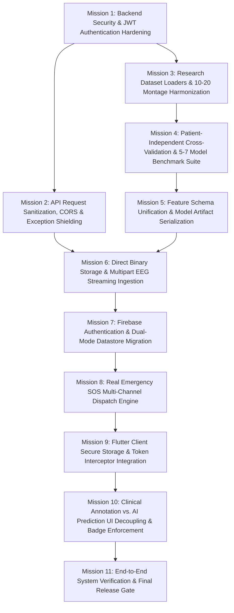

# NeuroGuard AI — Master Implementation Roadmap (Round 3+)

**Document Version:** 1.0.0 — Final  
**Status:** 🔒 **LOCKED & DEPENDENCY-SEQUENCED**  
**Date:** September 3, 2026  
**Governance Framework:** `CHANGE_CONTROL_RULES.md`, `SECURITY_RULES.md`, `MEDICAL_SAFETY_RULES.md`, `ML_RESEARCH_RULES.md`, and `FINAL_ARCHITECTURE.md`

---

## 1. SEQUENCED MISSION DEPENDENCY GRAPH

---

## 2. DETAILED MISSION SPECIFICATIONS

---

### MISSION 1: Backend Security & JWT Authentication Hardening
- **Primary Objective:** Implement stateless JWT authentication on the Flask backend, generate Bearer tokens on `/login` and `/signup`, introduce an `@require_auth` decorator verifying user IDs and roles (`patient` vs `doctor`), and eliminate the unauthenticated `/update_password` bypass.
- **Dependencies:** None (First implementation mission of Round 3).
- **Definition of Ready:** All Round 2 audit documents reviewed; baseline passing test suite verified (`run_api_tests.py`).
- **Files / Areas Expected to Change:**
  - `lib/screens/auth/app.py` (Add token issuance, `@require_auth` decorator, secure password reset).
  - `requirements.txt` (Add `PyJWT`).
  - `run_api_tests.py` (Update test suite to assert Bearer token authentication).
- **What Must NOT Change:** Database schema DDL, ML inference pipeline, signal processing algorithms, Flutter UI screens.
- **Testing Required:**
  - Unit test token generation and signature verification.
  - Assert HTTP 401 Unauthorized when querying `/get_patient_details` without token.
  - Assert HTTP 403 Forbidden when a patient token attempts doctor endpoints (`/get_all_patients`).
  - Verify password changes require valid token or verified current password.
- **Acceptance Criteria:** All 49 endpoints reject unauthenticated or cross-tenant requests; `/update_password` requires authentication; 100% test pass on `run_api_tests.py`.
- **Rollback Method:** Revert Git commit to baseline checkpoint branch `checkpoint/baseline-pre-audit`.

---

### MISSION 2: API Request Sanitization, CORS & Exception Shielding
- **Primary Objective:** Harden the Flask API perimeter by replacing wildcard CORS with strict origin whitelists, setting `MAX_CONTENT_LENGTH = 50MB`, removing debug prints logging password hash prefixes, disabling `debug=True` in production config, and establishing centralized error handlers that return generic error messages while logging details server-side.
- **Dependencies:** Mission 1.
- **Definition of Ready:** Mission 1 completed and verified with passing test suite.
- **Files / Areas Expected to Change:**
  - `lib/screens/auth/app.py` (CORS configuration, payload size limits, exception handlers).
  - `lib/screens/auth/seizure_prediction_api.py` (Sanitize error responses).
- **What Must NOT Change:** Endpoint URL paths, input request schemas, ML models, Flutter UI screens.
- **Testing Required:**
  - Verify HTTP 413 Payload Too Large when uploading files > 50MB.
  - Verify HTTP 500 error responses return generic message `{"status": "error", "message": "An internal server error occurred"}` without stack trace exposure.
  - Verify console logs contain zero plaintext passwords, tokens, or hash prefixes.
- **Acceptance Criteria:** No internal SQL or filesystem paths exposed in API error JSON; payload limits enforced; CORS origin-restricted.
- **Rollback Method:** Revert commit; restore previous Flask configuration.

---

### MISSION 3: Research Dataset Loaders & 10-20 Montage Harmonization
- **Primary Objective:** Implement an isolated clinical dataset ingestion pipeline in `ml_models/research/` capable of parsing CHB-MIT Scalp EEG (`.edf` + `.seizures`) and Siena Scalp EEG datasets with automated 10–20 International System electrode montage harmonization and patient ID metadata extraction.
- **Dependencies:** Mission 1.
- **Definition of Ready:** Research directory structure created; `mne` and `pyedflib` libraries available in environment.
- **Files / Areas Expected to Change:**
  - `ml_models/research/dataset_loaders.py` [NEW]
  - `ml_models/research/montage_harmonizer.py` [NEW]
  - `ml_models/research/annotation_parser.py` [NEW]
- **What Must NOT Change:** Production inference pipeline (`ml_models/production_pipeline.py`), Flask backend routes, Flutter frontend.
- **Testing Required:**
  - Automated test reading sample `.edf` records from CHB-MIT and Siena format.
  - Verify channel alignment mappers convert 23-channel bipolar and 29-channel referential setups into common 10–20 electrode representations.
  - Verify seizure onset/offset seconds match official dataset annotations.
- **Acceptance Criteria:** Dataset loader parses multi-patient records into standardized `(n_channels, n_samples)` arrays with verified patient ID labels.
- **Rollback Method:** Delete new files in `ml_models/research/`.

---

### MISSION 4: Patient-Independent Cross-Validation & 5-7 Model Benchmark Suite
- **Primary Objective:** Implement a rigorous, leak-free patient-independent evaluation engine using `GroupKFold` (by Patient ID) across 5–7 scientifically justified models (Logistic Regression, RBF-SVC, Random Forest, XGBoost/LightGBM, 1D-CNN, EEGNet, and BiLSTM) computing full clinical metrics (Sensitivity, Specificity, F1, FPR/h, Latency, ROC-AUC, PR-AUC, Confusion Matrix).
- **Dependencies:** Mission 3.
- **Definition of Ready:** Mission 3 dataset loader tested and verified; clinical dataset available.
- **Files / Areas Expected to Change:**
  - `ml_models/research/benchmark_suite.py` [NEW]
  - `ml_models/research/metrics_calculator.py` [NEW]
  - `ml_models/research/train_models.py` [NEW]
- **What Must NOT Change:** Live API serving, production model weights, database schemas.
- **Testing Required:**
  - Verify zero patient overlap between train and test splits in every fold.
  - Verify feature scaling is fitted strictly inside train folds without test leakage.
  - Generate full multi-class confusion matrix and print formatted leaderboard.
- **Acceptance Criteria:** Complete reproducible benchmark report with verified patient-independent metrics; no fabricated results or data leakage.
- **Rollback Method:** Discard benchmark experiment run scripts.

---

### MISSION 5: Feature Schema Unification & Model Artifact Serialization
- **Primary Objective:** Standardize the production feature extraction schema to use all 40 spectral, temporal, and dynamic features (eliminating the 40-to-16 truncation), serialize the best-performing calibrated model from Mission 4 under the active runtime scikit-learn version, and update `seizure_meta.json` with standardized ILAE seizure class names.
- **Dependencies:** Mission 4.
- **Definition of Ready:** Best model selected from benchmark suite; clinical metrics verified.
- **Files / Areas Expected to Change:**
  - `ml_models/production_pipeline.py` (Update feature dimension alignment to 40 features).
  - `ml_models/seizure_model_production.joblib` (Update model artifact).
  - `ml_models/seizure_scaler.joblib` (Update scaler artifact).
  - `ml_models/seizure_feature_selector.joblib` (Update selector artifact).
  - `ml_models/seizure_meta.json` (Update schema metadata).
- **What Must NOT Change:** Flask route definitions, database schemas, Flutter screens.
- **Testing Required:**
  - Unit test `predict_from_raw()` asserting 40 features are processed without truncation.
  - Verify `InconsistentVersionWarning` is completely eliminated on unpickling.
  - Verify returned class labels match clinical names (`Focal Seizure`, `Generalized Seizure`, `Absence Seizure`, `Normal`).
- **Acceptance Criteria:** Model outputs clinical class labels and calibrated probabilities on 40-feature inputs with zero runtime warnings.
- **Rollback Method:** Restore previous `.joblib` and `.json` artifacts from backup.

---

### MISSION 6: Direct Binary Storage & Multipart EEG Streaming Ingestion
- **Primary Objective:** Upgrade EEG file upload endpoints from synchronous in-memory Base64 JSON payloads to multipart/form-data chunked streaming and signed URL storage references, eliminating worker RAM bloat.
- **Dependencies:** Mission 2, Mission 5.
- **Definition of Ready:** Model inference pipeline stabilized on 40 features.
- **Files / Areas Expected to Change:**
  - `lib/screens/auth/seizure_prediction_api.py` (Update `/predict_seizure_from_eeg` and `/predict_batch` to support multipart streaming).
  - `ml_models/production_pipeline.py` (Add streaming file-like buffer reader).
- **What Must NOT Change:** Model mathematics, feature extraction algorithms, PDF report formatting.
- **Testing Required:**
  - Upload 10MB, 25MB, and 45MB `.edf` files via multipart/form-data.
  - Monitor Flask process memory usage to confirm constant low RAM utilization.
- **Acceptance Criteria:** Memory overhead reduced by >50%; large clinical EEG files process cleanly without OOM exceptions.
- **Rollback Method:** Revert endpoint modifications; restore previous base64 parser fallback.

---

### MISSION 7: Firebase Authentication & Dual-Mode Datastore Migration
- **Primary Objective:** Integrate Firebase Authentication SDK in the backend/client, configure Cloud Firestore collections with strict security rules (`request.auth.uid == userId`), and establish dual-write data migration from MySQL/SQLite with parity validation and instantaneous rollback flags.
- **Dependencies:** Mission 1, Mission 6.
- **Definition of Ready:** Pre-migration MySQL/SQLite database backup created; Firebase project credentials secured.
- **Files / Areas Expected to Change:**
  - `lib/screens/auth/db_fallback.py` (Add Firestore adapter with feature flag).
  - `lib/screens/auth/app.py` (Integrate Firebase Auth token verification).
  - `firestore.rules` [NEW]
  - `storage.rules` [NEW]
- **What Must NOT Change:** Offline SQLite fallback capability, signal processing pipeline, ML models.
- **Testing Required:**
  - Test user signup and login across Firebase Auth and local fallback.
  - Execute data parity check comparing document counts between SQL and Firestore.
  - Verify Firestore security rules reject unauthenticated document reads.
- **Acceptance Criteria:** Dual-mode persistence operational; Firebase Auth tokens validated by backend; zero data loss during dual-write.
- **Rollback Method:** Set `USE_FIREBASE_DATASTORE=false` in environment to instantaneously revert all traffic to local SQLite/MySQL.

---

### MISSION 8: Real Emergency SOS Multi-Channel Dispatch Engine
- **Primary Objective:** Upgrade the emergency workflow from a local database log to a real automated dispatch engine integrating Twilio SMS (with GPS coordinates) to family contacts, high-priority FCM push to assigned doctors, and native hardware phone dialer intents.
- **Dependencies:** Mission 7.
- **Definition of Ready:** Emergency contacts table migrated; Twilio/FCM service credentials configured in environment variables.
- **Files / Areas Expected to Change:**
  - `lib/screens/auth/seizure_prediction_api.py` (Implement real SMS and FCM dispatch inside `/send_emergency_alert`).
  - `lib/screens/patient/emergency_alert_screen.dart` (Add hardware phone dialer trigger).
- **What Must NOT Change:** Core user auth, ML inference pipeline, medical charts.
- **Testing Required:**
  - Trigger simulated emergency SOS and verify automated SMS delivery with test phone numbers.
  - Verify high-priority push notification received on doctor client device.
- **Acceptance Criteria:** Real multi-channel alert dispatched in < 2.0 seconds; emergency record logged with timestamp.
- **Rollback Method:** Revert dispatch handler; disable SMS gateway flag.

---

### MISSION 9: Flutter Client Secure Storage & Token Interceptor Integration
- **Primary Objective:** Migrate Flutter sensitive credential storage from plaintext `SharedPreferences` to `FlutterSecureStorage`, implement an HTTP client interceptor automatically attaching `Authorization: Bearer <token>` to all outgoing backend requests, and update API service classes.
- **Dependencies:** Mission 1, Mission 7.
- **Definition of Ready:** Backend JWT authentication active; `flutter_secure_storage` package added to `pubspec.yaml`.
- **Files / Areas Expected to Change:**
  - `pubspec.yaml` (Add `flutter_secure_storage`).
  - `lib/services/api_service.dart` [NEW / UPDATE]
  - `lib/services/prediction_service.dart` (Attach Bearer tokens and handle multipart uploads).
  - `lib/screens/auth/login_screen.dart` (Persist JWT in secure storage).
- **What Must NOT Change:** UI screen layouts, color schemes, doctor chart views.
- **Testing Required:**
  - Verify JWT token is saved into iOS Keychain / Android Keystore.
  - Verify API requests succeed with valid tokens and redirect to login upon token expiration.
- **Acceptance Criteria:** Plaintext credential storage eliminated; Flutter client communicates seamlessly with protected backend.
- **Rollback Method:** Revert Flutter HTTP service modifications.

---

### MISSION 10: Clinical Annotation vs. AI Prediction UI Decoupling & Badge Enforcement
- **Primary Objective:** Update the Flutter UI to strictly decouple automated AI predictions from doctor clinical annotations, enforce the mandatory `AI ASSISTED - NOT CLINICAL DIAGNOSIS` visual badge, and implement the doctor review verification flow.
- **Dependencies:** Mission 5, Mission 9.
- **Definition of Ready:** Models outputting standardized clinical class labels; Flutter auth working.
- **Files / Areas Expected to Change:**
  - `lib/screens/patient/upload_eeg_screen.dart` (Add AI badge and disclaimer).
  - `lib/screens/doctor/doctor_dashboard.dart` (Add clinician annotation review dialog).
  - `lib/models/seizure_prediction_model.dart` (Decouple AI prediction from doctor diagnosis).
- **What Must NOT Change:** Backend signal processing, ML model weights.
- **Testing Required:**
  - Verify AI badge renders prominently on all automated prediction screens.
  - Verify doctor annotations create distinct verified records without overwriting raw AI prediction history.
- **Acceptance Criteria:** 100% compliance with `MEDICAL_SAFETY_RULES.md`; clear clinical auditability.
- **Rollback Method:** Revert UI widget modifications.

---

### MISSION 11: End-to-End System Verification & Final Release Gate
- **Primary Objective:** Execute full end-to-end integration testing across the entire system (Flutter UI $\rightarrow$ Firebase Auth $\rightarrow$ Python Backend $\rightarrow$ DSP $\rightarrow$ ML Inference $\rightarrow$ Report Generation $\rightarrow$ Emergency SOS), verify zero regressions, perform static analysis (`dart analyze`, `pytest`), and lock the production release candidate.
- **Dependencies:** Missions 1 through 10.
- **Definition of Ready:** All previous 10 missions completed, individually tested, and signed off.
- **Files / Areas Expected to Change:**
  - `tests/e2e_integration_test.py` [NEW]
  - `RELEASE_NOTES_V1.md` [NEW]
- **What Must NOT Change:** Core architecture and locked models.
- **Testing Required:**
  - Run full automated test suite (`pytest tests/`).
  - Run Flutter analysis (`dart analyze`).
  - Perform live clinical workflow walkthrough.
- **Acceptance Criteria:** 100% automated test pass rate; zero critical security/safety defects; release candidate approved.
- **Rollback Method:** Fix forward or rollback to Mission 10 checkpoint.
