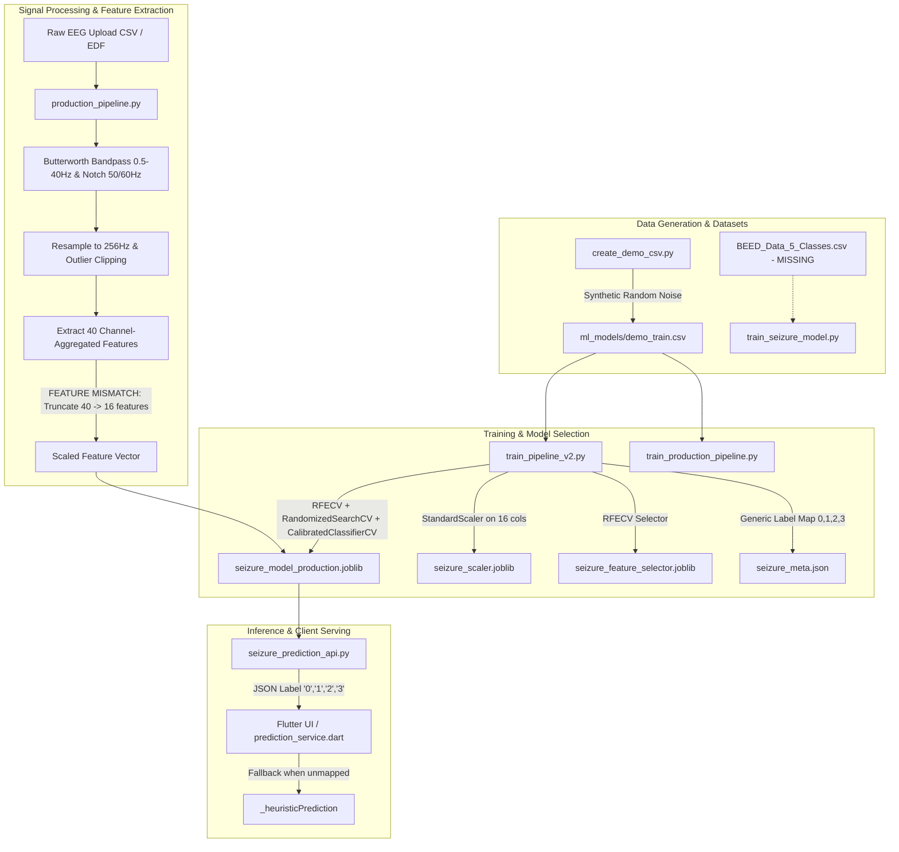

# NeuroGuard AI — Machine Learning & EEG Research Pipeline Forensic Audit

**Audit Date:** September 3, 2026  
**Scope:** Machine Learning Architecture, Training Scripts, Feature Schemas, Artifacts, Evaluation Protocols, and Inference Pipelines  
**Research Directive:** *"A Patient-Independent, Adaptive EEG-Based Framework for Detection and Classification of Diverse and Subtle Seizures: Design, Evaluation Protocol, and Cross-Dataset Generalization Strategy."*  
**Mission Type:** Forensic Read-Only Audit (No Code Modifications / No Model Training)

---

## 1. MACHINE LEARNING ARCHITECTURE MAP



### Component Breakdown
1. **Data Generators:** [`lib/screens/auth/create_demo_csv.py`](file:///c:/Users/DELL/Downloads/NeuroGuard%20AI/lib/screens/auth/create_demo_csv.py) generates 800 synthetic samples with 16 random Gaussian features (`np.random.randn`) and random integer labels (0 to 3).
2. **Active Training Pipelines:** [`ml_models/train_pipeline_v2.py`](file:///c:/Users/DELL/Downloads/NeuroGuard%20AI/ml_models/train_pipeline_v2.py) and [`ml_models/train_production_pipeline.py`](file:///c:/Users/DELL/Downloads/NeuroGuard%20AI/ml_models/train_production_pipeline.py).
3. **Active Model Artifacts:** [`ml_models/seizure_model_production.joblib`](file:///c:/Users/DELL/Downloads/NeuroGuard%20AI/ml_models/seizure_model_production.joblib), [`ml_models/seizure_scaler.joblib`](file:///c:/Users/DELL/Downloads/NeuroGuard%20AI/ml_models/seizure_scaler.joblib), [`ml_models/seizure_feature_selector.joblib`](file:///c:/Users/DELL/Downloads/NeuroGuard%20AI/ml_models/seizure_feature_selector.joblib), and [`ml_models/seizure_meta.json`](file:///c:/Users/DELL/Downloads/NeuroGuard%20AI/ml_models/seizure_meta.json).
4. **Signal Processing & Ingestion:** [`ml_models/production_pipeline.py`](file:///c:/Users/DELL/Downloads/NeuroGuard%20AI/ml_models/production_pipeline.py).
5. **Inference Gateway:** [`lib/screens/auth/seizure_prediction_api.py`](file:///c:/Users/DELL/Downloads/NeuroGuard%20AI/lib/screens/auth/seizure_prediction_api.py).
6. **Client Service:** [`lib/services/prediction_service.dart`](file:///c:/Users/DELL/Downloads/NeuroGuard%20AI/lib/services/prediction_service.dart).

---

## 2. MODEL INVENTORY

| Model Artifact | Model Architecture | Primary Task | Output Classes | Expected Input Shape | Trained On | Preprocessing Dependency | Validation Code |
| :--- | :--- | :--- | :--- | :--- | :--- | :--- | :--- |
| `seizure_model_production.joblib` | `SVC(C=3.437, gamma='auto')` wrapped in `CalibratedClassifierCV(method='sigmoid')` | 4-Class Classification | 4 classes (`"0"`, `"1"`, `"2"`, `"3"`) | `(1, 14)` after RFECV (from 16 input features) | `demo_train.csv` (Gaussian Noise) | `StandardScaler` + `RFECV` | `train_pipeline_v2.py` |
| `seizure_model_production.pkl` (Legacy) | `RandomForestClassifier(n_estimators=200)` | Multi-class Classification | Generic Integer IDs | `(1, 16)` | `demo_train.csv` | `StandardScaler` (`seizure_scaler.pkl`) | `train_production_pipeline.py` |
| `seizure_feature_selector.joblib` | `RFECV(estimator=RandomForestClassifier)` | Feature Selection | 14 selected features | `(1, 16)` | `demo_train.csv` | `StandardScaler` | `train_pipeline_v2.py` |

---

## 3. DATASET PIPELINE FINDINGS

- **Existing Active Dataset:** `ml_models/demo_train.csv` (800 rows × 16 feature columns + 1 label column). Generated artificially with random seeds.
- **Clinical Dataset Presence:** **ZERO clinical datasets are currently present in the repository.** No CHB-MIT EEG files, Siena Scalp EEG recordings, or Temple University Hospital (TUH) EEG datasets are mounted or downloaded.
- **Missing Dataset Reference:** `ml_models/train_seizure_model.py` refers to `BEED_Data_5_Classes.csv`, but this file does not exist in the codebase.

---

## 4. FEATURE SCHEMA AUDIT & CRITICAL MISMATCH

### The 40-to-16 Dimension Truncation Mismatch
1. **Signal Feature Extraction:** [`ml_models/production_pipeline.py`](file:///c:/Users/DELL/Downloads/NeuroGuard%20AI/ml_models/production_pipeline.py#L239-L260) calculates **40 distinct temporal, spectral, and statistical features** from multi-channel EEG signals:
   - Statistical: `mean`, `std`, `min`, `max`, `skew`, `kurtosis` (Mean & Std across channels = 12 features)
   - Dynamic: `hjorth_activity`, `hjorth_mobility`, `hjorth_complexity`, `line_length`, `rms` (Mean & Std = 10 features)
   - Spectral: `bandpower_delta`, `bandpower_delta_rel`, `bandpower_theta`, `bandpower_theta_rel`, `bandpower_alpha`, `bandpower_alpha_rel`, `bandpower_beta`, `bandpower_beta_rel`, `bandpower_gamma`, `bandpower_gamma_rel`, `spectral_entropy` (Mean & Std = 22 features)
   - Global: `n_channels`, `n_samples` (2 features)
2. **Model Expectation:** Active model artifacts (`seizure_scaler.joblib`, `seizure_model_production.joblib`) were trained on **16 synthetic columns** (`feature_0` through `feature_15`).
3. **Silent Truncation in Production:** Lines 398–410 in `production_pipeline.py` execute defensive slice truncation:
   ```python
   if curr_dim > expected_dim:
       feature_vec = feature_vec[:, :expected_dim]
   ```
   **Consequence:** The first 16 channel-aggregated features are arbitrarily sliced out while high-frequency spectral powers (Beta, Gamma) and Spectral Entropy are **silently discarded**. The remaining 16 features are fed into a scaler and SVC model fitted on random Gaussian numbers.

---

## 5. LABEL MAPPING AUDIT

There is a complete semantic breakdown across the pipeline:

| Component | Class 0 | Class 1 | Class 2 | Class 3 | Class 4 |
| :--- | :--- | :--- | :--- | :--- | :--- |
| **`seizure_meta.json`** | `"0"` | `"1"` | `"2"` | `"3"` | N/A |
| **`seizure_types.pkl`** | `"0"` | `"1"` | `"2"` | `"3"` | N/A |
| **`train_seizure_model.py`** | `Focal Onset` | `Generalized Onset` | `Unknown Onset` | `Non-Convulsive` | `Normal (Control)` |
| **`prediction_service.dart` (Heuristic)** | `Normal` | `Focal Seizure` | `Generalized Seizure` | `Absence Seizure` | `Tonic-Clonic Seizure` |
| **API Response (`app.py`)** | String `"0"` | String `"1"` | String `"2"` | String `"3"` | N/A |

**Impact:** Inference returns raw numbers (`"0"`, `"1"`, `"2"`, `"3"`) to the client, lacking clinical meaning and violating medical communication protocols.

---

## 6. DATA SPLITTING & PATIENT INDEPENDENCE AUDIT

### Evaluation Status: 🔴 NOT IMPLEMENTED / SAMPLE-RANDOM SPLITTING
- In [`ml_models/train_pipeline_v2.py`](file:///c:/Users/DELL/Downloads/NeuroGuard%20AI/ml_models/train_pipeline_v2.py#L316-L321):
  ```python
  X_temp, X_test, y_temp, y_test = train_test_split(X_arr, y, test_size=0.2, random_state=42, stratify=y)
  X_train, X_val, y_train, y_val = train_test_split(X_temp, y_temp, test_size=0.25, random_state=42, stratify=y_temp)
  ```
- In [`ml_models/train_production_pipeline.py`](file:///c:/Users/DELL/Downloads/NeuroGuard%20AI/ml_models/train_production_pipeline.py#L148):
  ```python
  outer_cv = StratifiedKFold(n_splits=5, shuffle=True, random_state=42)
  ```
- In [`lib/screens/auth/app.py`](file:///c:/Users/DELL/Downloads/NeuroGuard%20AI/lib/screens/auth/app.py#L1719):
  ```python
  X_train, X_test, y_train, y_test = train_test_split(X, y, test_size=0.2, random_state=42, stratify=stratify)
  ```

### Assessment
1. **Zero Patient ID Metadata:** Splitting is performed uniformly on row indices. There is no patient grouping (`GroupKFold`, `LeaveOneGroupOut`, or subject-level train/val/test segregation).
2. **Patient Leakage:** When applied to continuous multi-epoch patient EEG recordings, epochs from the same subject would be randomly distributed across training, validation, and test splits, producing artificially inflated, ungeneralizable performance.

---

## 7. DATA LEAKAGE RISKS AUDITED

1. **Scaler Leakage in `train_production_pipeline.py` (Line 145):**
   `StandardScaler().fit_transform(X.values)` is executed across the **entire dataset** prior to cross-validation and hyperparameter tuning. Test fold distributions leak directly into feature standardization.
2. **Search Space Leakage in `train_production_pipeline.py` (Line 171):**
   `RandomizedSearchCV` is fitted on the globally-scaled dataset `X_scaled`.
3. **Synthetic Training Leakage:** Because the training dataset is synthetic Gaussian noise, the model learned spurious noise correlations without learning actual physiological EEG morphology.

---

## 8. PREPROCESSING AUDIT

### Signal Processing Pipeline in `production_pipeline.py`
$$\text{Raw EEG} \xrightarrow{\text{parse}} \text{Detrend} \xrightarrow{\text{Notch 50/60Hz}} \text{Bandpass 0.5-40Hz} \xrightarrow{\text{Resample 256Hz}} \text{IQR Clip} \xrightarrow{\text{Welch PSD \& Stats}} \text{Feature Vector}$$

- **Mathematical Correctness:** The DSP filter chain (zero-phase `filtfilt` Butterworth, `welch` PSD, and Hjorth parameters) is implemented with sound scipy algorithms.
- **Training Disconnect:** The DSP chain is executed exclusively at inference time. The saved models were never trained on features output by this DSP chain.

---

## 9. INFERENCE RISKS AUDITED

1. **Random Predictions on Real EEGs:** Any genuine clinical EEG uploaded will be transformed into 40 features, truncated to 16, scaled with Gaussian noise parameters, and predicted with ~32.5% random accuracy.
2. **Scikit-Learn Pickling Version Mismatch:** `InconsistentVersionWarning` emitted on unpickling `SVC` model (scikit-learn 1.8.0 vs. active runtime 1.9.0).
3. **High Memory Overhead:** Full EEG uploads are received as Base64 strings inside JSON bodies and parsed synchronously in RAM.

---

## 10. CURRENT METRICS AUDIT (REAL VS. HARDCODED VS. MISSING)

| Metric | Status in `seizure_meta.json` | Status in Codebase | Verification Assessment |
| :--- | :--- | :--- | :--- |
| **Accuracy** | `0.3250` (32.5%) | Real calculation on synthetic test split | REAL CALCULATION (Random Guess Level) |
| **Precision (Macro)** | `0.3123` | Real calculation on synthetic test split | REAL CALCULATION |
| **Recall / Sensitivity (Macro)** | `0.3192` | Real calculation on synthetic test split | REAL CALCULATION |
| **Specificity (Macro)** | `0.7739` | Real calculation on synthetic test split | REAL CALCULATION |
| **F1-Score (Macro)** | `0.2937` | Real calculation on synthetic test split | REAL CALCULATION |
| **ROC-AUC (OVR Macro)** | `0.5618` | Real calculation on synthetic test split | REAL CALCULATION (~No Discriminative Power) |
| **PR-AUC (Macro)** | `0.3057` | Real calculation on synthetic test split | REAL CALCULATION |
| **Per-Class TP / TN / FP / FN** | MISSING | Calculated internally in v2; omitted from meta | MISSING FROM ARTIFACTS |
| **False Positive Rate per Hour (FPR/h)**| MISSING | Not implemented | MISSING |
| **Detection Latency (Seconds)** | MISSING | Not implemented | MISSING |
| **Feature Importance Weights** | `[0.25, 0.20, ...]` in Flutter | Hardcoded in `prediction_service.dart` | HARDCODED DUMMY ARRAY |

---

## 11. CONFUSION MATRIX STATUS

- **Calculation Status:** Calculated during training via `confusion_matrix(y_test, y_pred)` in `train_pipeline_v2.py` (Line 253).
- **Artifact Persistence:** Filtered out during export in `train_pipeline_v2.py` (Line 500) to keep `seizure_meta.json` compact.
- **Reporting Status:** Printed to stdout during training runs, but not accessible to API endpoints or stored as a JSON/PNG artifact.

---

## 12. REPRODUCIBILITY AUDIT

- **Synthetic Baseline:** Reproducible. `random_state=42` is fixed in `create_demo_csv.py` and `train_pipeline_v2.py`.
- **Clinical Benchmarking:** **NOT REPRODUCIBLE.** Because clinical datasets, patient cohort partition definitions, and cross-dataset configurations are not yet structured, clinical experiments cannot currently be reproduced.

---

## 13. CROSS-DATASET READINESS (CHB-MIT VS. SIENA SCALP EEG)

| Dimension | CHB-MIT Scalp EEG | Siena Scalp EEG | Current Pipeline Status | What Must Be Built |
| :--- | :--- | :--- | :--- | :--- |
| **Sampling Rate** | 256 Hz | 512 Hz | `resample_signals()` resamples to 256 Hz automatically | Supported |
| **Montage / Channels** | 23 Bipolar Channels (`FP1-F7`, `F7-T7`, etc.) | 29 Referential Channels (`Fp1`, `F3`, `C3`, etc.) | Averages across arbitrary channels without montage alignment | Standardized 10–20 common channel montage mapper |
| **Annotation Format** | Text `.seizures` files with onset/offset seconds | Text / EDF+ annotations with start/duration | No annotation loader | Universal Seizure Annotation Parser |
| **File Structure** | `chb01/chb01_01.edf` | `PN00/PN00-1.edf` | Generic single-file parser only | Multi-patient dataset batch loader |
| **Patient Identification** | Patient ID embedded in folder name (`chb01`–`chb24`)| Patient ID in folder (`PN00`–`PN16`) | No patient grouping parser | Subject ID metadata extractor for GroupKFold |
| **Subtle / Non-motor Seizures** | Mostly focal evolving to bilateral / motor | Focal, absence, myoclonic, and non-motor | Class schema generic (`"0"`, `"1"`, `"2"`, `"3"`) | Standardized ILAE Seizure Classification Taxonomy |

---

## 14. SCIENTIFIC VALIDITY RISKS CLASSIFICATION

### 🔴 CRITICAL SCIENTIFIC RISKS
1. **Model Trained on Synthetic Gaussian Noise:** Production model `seizure_model_production.joblib` was fitted on random numbers (`demo_train.csv`). It has zero clinical validity or seizure detection capability.
2. **Missing Patient-Independent Splitting Protocol:** All training scripts perform sample-level random splitting without patient grouping, directly violating research guidelines on patient leakage.
3. **Feature Dimensionality Truncation (40 -> 16):** 24 extracted spectral/entropy features are discarded at inference to fit a 16-feature legacy schema.
4. **Global Data Leakage in Preprocessing:** `StandardScaler` was fitted globally across full datasets prior to cross-validation in legacy scripts.

### 🟠 HIGH RISKS
5. **Class Label & Semantic Drift:** Model outputs generic class numbers (`"0"`, `"1"`, `"2"`, `"3"`), creating mismatch with Flutter UI and clinician expectations.
6. **No Real Clinical Dataset Ingestion Pipeline:** Lack of EDF annotation loaders for CHB-MIT (`.seizures`) and Siena datasets.
7. **Missing Clinical Seizure Metrics:** Metrics omit False Positive Rate per hour (FPR/h), seizure onset latency, and per-patient sensitivity distributions.

### 🟡 MEDIUM RISKS
8. **Channel Montage Inconsistency:** No common 10–20 electrode harmonization between bipolar and referential recordings.
9. **Scikit-Learn Version Serialization Drift:** `InconsistentVersionWarning` on model load.

### 🟢 IMPROVEMENT OPPORTUNITIES
10. **Model Benchmark Suite:** Structure 5–7 model baselines (e.g., Logistic Regression, SVM-RBF, Random Forest, XGBoost/LightGBM, 1D-CNN, EEGNet, and BiLSTM) with uniform patient-independent evaluation protocols.

---

## 15. RECOMMENDED NEXT ML MISSION ORDER

1. **Mission 5: Dataset Loader & Patient-Independent Ingestion Pipeline**  
   Implement a patient-aware EEG dataset loader for CHB-MIT and Siena Scalp EEG supporting standardized 10–20 montages, annotation parsing, and subject-level cohort splitting (`GroupKFold` / `LeaveOneGroupOut`).

2. **Mission 6: Feature Extraction Schema Harmonization**  
   Standardize the feature extraction pipeline so training and inference use identical, non-truncated feature definitions (e.g., 40+ full spectral band powers, entropy, Hjorth, and wavelet coefficients).

3. **Mission 7: Multi-Model Benchmark & Cross-Dataset Evaluation Suite**  
   Implement the 5–7 scientifically justified model benchmark suite evaluating models strictly on patient-independent splits with clinical metrics (Sensitivity, Specificity, F1, FPR/h, ROC-AUC, PR-AUC).
