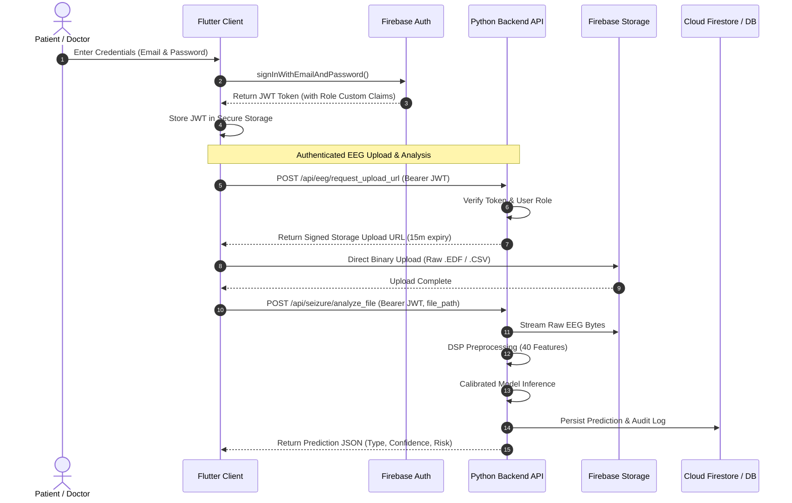
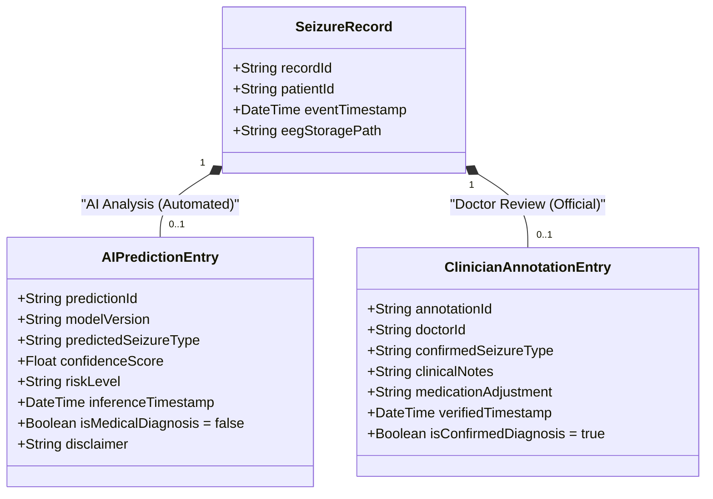
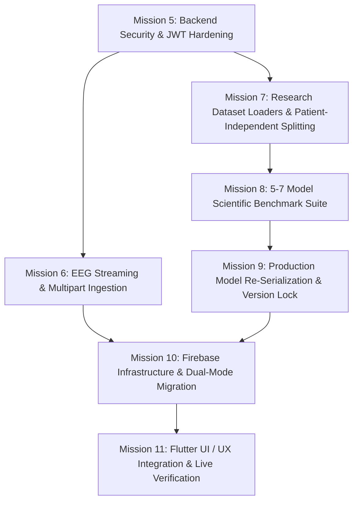

# NeuroGuard AI — Final Technical Architecture Specification

**Architecture Status:** 🔒 **LOCKED & DEPENDENCY-ALIGNED**  
**Specification Date:** September 3, 2026  
**Grounded In:** `FLUTTER_AUDIT.md`, `BACKEND_AUDIT.md`, `ML_AUDIT.md`, `FEATURE_REALITY_MATRIX.md`, `DATABASE_MIGRATION_AUDIT.md`, and `SECURITY_PRIVACY_AUDIT.md`  
**Core Directive:** *"A Patient-Independent, Adaptive EEG-Based Framework for Detection and Classification of Diverse and Subtle Seizures: Design, Evaluation Protocol, and Cross-Dataset Generalization Strategy."*

---

## 1. COMPONENT TOPOLOGY & RESPONSIBILITY BOUNDARIES

```mermaid
flowchart TD
    subgraph Client Tier [Cross-Platform Mobile & Web]
        Flutter[Flutter UI Layer\n- Screens & Presentation\n- Secure Token Storage\n- State Management]
    end

    subgraph Identity & Edge Cloud Tier [Firebase Cloud Services]
        FirebaseAuth[Firebase Auth\n- Identity Verification\n- JWT Bearer Tokens\n- Custom Role Claims]
        Firestore[Cloud Firestore\n- App Metadata & States\n- Notification Flags\n- UI Synchronization]
        FirebaseStorage[Firebase Storage\n- Raw EEG Files (.edf/.csv)\n- Clinical PDF Reports\n- Waveform PNG Images]
        FCM[Firebase Cloud Messaging\n- Native APNs/FCM Push\n- Critical SOS Alarms]
    end

    subgraph Secure Backend Compute Tier [Python Backend Service]
        AuthGuard[Stateless JWT & RBAC Guard\n- Token Validation\n- Patient/Doctor Scoping\n- Audit Logging Engine]
        DSP[Signal Processing Core\n- 0.5-40Hz Bandpass & Notch\n- Polyphase Resampling 256Hz\n- 40 Spectral/Hjorth Features]
        InferenceEngine[Model Serving Engine\n- Versioned Model Cache\n- Uncertainty & Calibration\n- Multi-Class Seizure Mapping]
        ReportGen[ReportLab PDF Compiler\n- Vector Waveform Embedding\n- Medical Disclaimers]
        DataBridge[Dual Database Adapter\n- MySQL / SQLite / Firestore]
    end

    subgraph Scientific Research Engine Tier [Isolated Offline Compute]
        ResearchCore[Experiment & Benchmark Suite\n- CHB-MIT & Siena Scalp Loaders\n- 10-20 Montage Harmonizer\n- Patient-Independent GroupKFold\n- 5-7 Model Benchmark Suite\n- FPR/h, Sensitivity, ROC-AUC]
        ModelRegistry[Model Version Registry\n- Metadata JSON Schemas\n- Scaler & Selector Joblibs\n- Confusion Matrix Artifacts]
    end

    %% Client Connections
    Flutter -->|1. Sign in / Obtain JWT| FirebaseAuth
    Flutter -->|2. Stream Real-Time Settings| Firestore
    Flutter -->|3. Signed Direct Upload| FirebaseStorage
    Flutter -->|4. Authenticated REST API Calls| AuthGuard

    %% Backend Routing
    AuthGuard --> DSP
    AuthGuard --> ReportGen
    AuthGuard --> DataBridge
    DSP --> InferenceEngine
    InferenceEngine --> DataBridge
    ReportGen --> FirebaseStorage
    DataBridge --> Firestore
    DataBridge --> FCM

    %% Research Flow
    ResearchCore --> ModelRegistry
    ModelRegistry -.->|Validated & Certified Weights| InferenceEngine
```

---

## 2. DETAILED TIER RESPONSIBILITIES

### A. Flutter Presentation Tier
- **Responsibilities:**
  - View presentation and reactive UI state (patient/doctor screens).
  - Secure credential and JWT token persistence using `FlutterSecureStorage` (migrating from plaintext SharedPreferences).
  - Local file picking and direct upload delegation via short-lived signed URLs.
  - Interactive EEG waveform viewing and clinical report downloading.
  - Visual distinction between AI Predictions and Clinician Annotations.
- **Strict Prohibitions:**
  - **NEVER** perform raw ML feature calculation or model execution in Flutter.
  - **NEVER** evaluate role-based access rules purely client-side without backend token verification.
  - **NEVER** fabricate heuristic fake predictions when the backend is offline (must clearly state "Offline/Unavailable").

### B. Firebase Cloud Services Tier
- **1. Firebase Authentication:**
  - Issues cryptographic JSON Web Tokens (JWT) containing Custom User Claims (`role: 'patient'` or `role: 'doctor'`).
- **2. Cloud Firestore:**
  - Structured, low-latency document persistence: user profile settings, notification switches, privacy flags, and active medication catalogs.
  - Enforces strict security rules: `request.auth.uid == resource.data.user_id`.
- **3. Firebase Storage:**
  - Secure binary object storage for large clinical EEG files (`.edf`, `.csv`), waveform PNG images, and ReportLab PDF reports.
  - Accessible strictly through authenticated signed URLs with 15-minute expiration windows.
- **4. Firebase Cloud Messaging (FCM):**
  - Native push delivery for background medication reminders and critical emergency SOS dispatches.

### C. Python Backend Compute Tier
- **Responsibilities:**
  - **Stateless Authentication Guard:** Decodes Firebase Auth JWTs on every incoming HTTP request, validates role claims, and enforces object-level access controls.
  - **Digital Signal Processing (DSP):** Deterministic multi-channel EEG filtering (0.5–40 Hz Butterworth), 50/60 Hz notch filtering, polyphase resampling to 256 Hz, and 40-dimensional feature extraction.
  - **Production Model Serving:** Executes cached, versioned scikit-learn/PyTorch models with probability calibration and uncertainty estimation.
  - **Clinical Report Compilation:** Generates multi-page PDF documents via ReportLab, embeds high-resolution vector waveforms, and uploads directly to Firebase Storage.
  - **Audit Logging Engine:** Records every clinical record access into an immutable append-only audit trail.

### D. Scientific ML Research & Experimentation Engine (Isolated)
- **Responsibilities:**
  - **Dataset Ingestion:** Dedicated parsers for CHB-MIT Scalp EEG (`.edf` + `.seizures`) and Siena Scalp EEG datasets.
  - **Montage Harmonization:** Standardized 10–20 International System electrode mapping (harmonizing bipolar and referential recordings).
  - **Patient-Independent Validation Protocol:** `GroupKFold` (by Patient ID) and `LeaveOneGroupOut` cross-validation preventing patient overlap and data leakage.
  - **Multi-Model Benchmark Suite (5–7 Models):**
    1. *Baseline 1:* Regularized Logistic Regression / Linear SVM
    2. *Baseline 2:* Calibrated Non-Linear Support Vector Classifier (RBF-SVC)
    3. *Tree Ensemble 1:* Balanced Random Forest Classifier
    4. *Tree Ensemble 2:* Gradient Boosting (XGBoost / LightGBM)
    5. *Deep Learning 1:* 1D-CNN Spectral-Temporal Network
    6. *Deep Learning 2:* EEGNet (Compact Spatial-Temporal Convolutional Network)
    7. *Deep Learning 3:* Bi-Directional LSTM with Attention
  - **Clinical Metric Suite:** Patient-level sensitivity (Recall), Specificity, Macro F1, False Positive Rate per hour (FPR/h), Seizure Onset Latency (seconds), ROC-AUC, PR-AUC, and full Confusion Matrices.
  - **Model Registry & Release Gating:** Exports serializations (`.joblib` / `.pt`) only when models satisfy minimum clinical criteria and zero data leakage.

---

## 3. DATA & AUTHENTICATION FLOW

### A. End-to-End Authenticated Request Flow


---

## 4. STRICT SEPARATION: AI PREDICTION VS. CLINICIAN ANNOTATION

To ensure clinical safety and medical compliance, AI predictions and doctor annotations are strictly decoupled in data schemas and user interfaces:



### Architectural Rules:
1. **No Silent Overwrites:** An AI prediction cannot overwrite a doctor's annotation, and a doctor's annotation does not alter historical AI inference records.
2. **Mandatory AI Badge:** In the Flutter UI, all automated inferences must render with an explicit `AI ASSISTED - NOT CLINICAL DIAGNOSIS` visual badge.
3. **Doctor Verification Workflow:** When a doctor reviews a seizure event, a distinct `ClinicianAnnotationEntry` document is created with the doctor's verified credentials and medical timestamp.

---

## 5. CHATBOT & EMERGENCY ARCHITECTURAL BOUNDARIES

### A. AI Medical Chatbot Boundaries
- **Strict Role:** Educational support and symptom navigation assistant.
- **Architecture:** Managed via backend proxy with strict system prompt guardrails.
- **Safety Boundaries:**
  - **NEVER** prescribe medications or suggest dosage alterations.
  - **NEVER** issue definitive clinical diagnoses.
  - **Emergency Trigger:** If keywords indicate status epilepticus or active physical danger (e.g. *"seizure lasting > 5 minutes"*, *"difficulty breathing"*, *"head injury"*), the chatbot must immediately halt conversational response and display the high-contrast **Emergency SOS Dispatch Dialog**.

### B. Emergency SOS Architecture
- **Trigger:** Immediate user tap on Emergency SOS or automated high-confidence critical seizure alert.
- **Backend Flow:**
  1. Immediately records emergency event in `seizure_alerts` collection.
  2. Invokes **Twilio / SMS Gateway** to dispatch automated SMS with GPS location to all registered `family_contacts`.
  3. Dispatches high-priority **Firebase Cloud Messaging (FCM)** push to assigned doctor devices.
  4. Triggers device hardware phone dialer intent (`tel:112` or local emergency services).

---

## 6. SECURITY BOUNDARIES & PHI ACCESS MATRIX

| Role | Demographics | Medical Conditions | Prescriptions | Raw EEG Files | AI Predictions | Doctor Notes | Audit Logs |
| :--- | :--- | :--- | :--- | :--- | :--- | :--- | :--- |
| **Patient (Owner)** | Read / Write (Self) | Read (Self) | Read (Self) | Read / Write (Self) | Read (Self) | Read (Self) | Denied |
| **Doctor (Assigned)**| Read (Assigned) | Read / Write (Assigned)| Read / Write (Assigned)| Read (Assigned) | Read (Assigned) | Read / Write (Assigned)| Denied |
| **Unassigned Doctor**| Denied | Denied | Denied | Denied | Denied | Denied | Denied |
| **Backend Service** | Read / Write (Scoped)| Read / Write | Read / Write | Read / Process | Read / Write | Read / Write | Append Only |
| **Audit Officer** | Denied | Denied | Denied | Denied | Denied | Denied | Read Only |

---

## 7. FUTURE MISSION DEPENDENCY GRAPH


